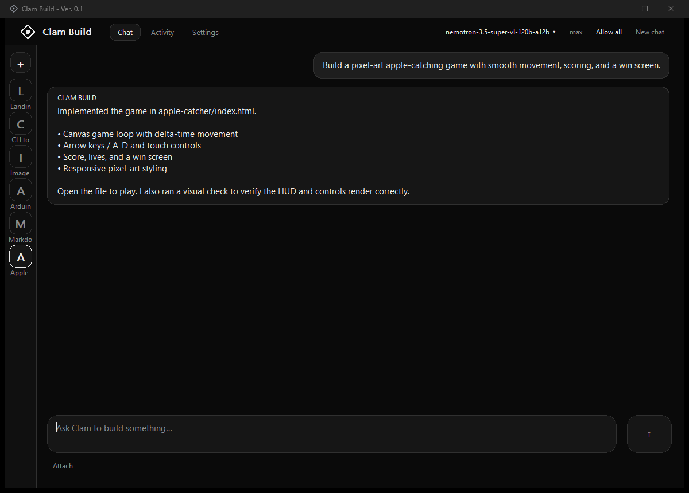
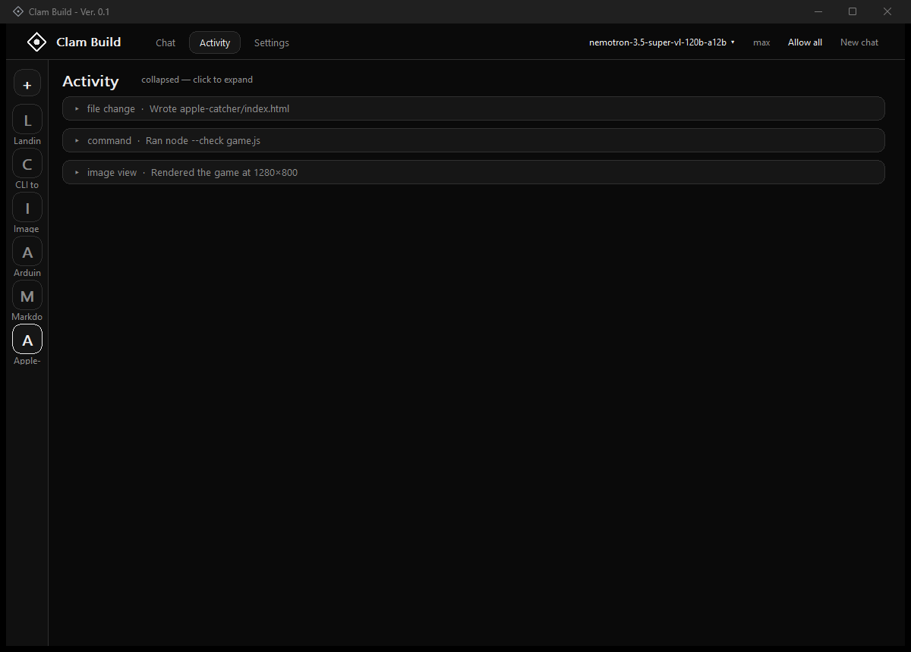
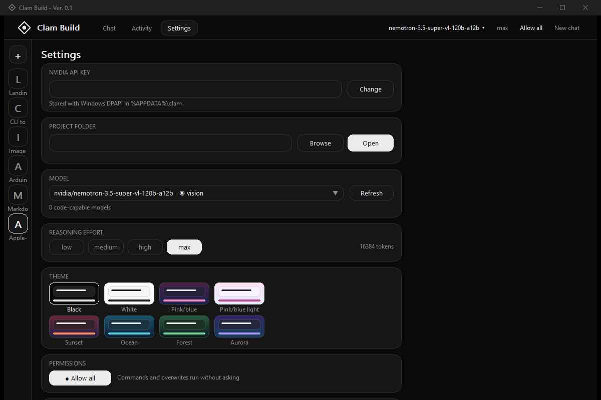

# Clam Build

**Ver. 0.1** · A native Windows coding agent in one small executable.

[Website](https://lettermantest.github.io/clam-build/) · [Download](https://github.com/lettermantest/clam-build/releases/latest) · [Source](https://github.com/lettermantest/clam-build)

Clam Build is a desktop coding agent for Windows. Point it at a project, describe the outcome, and it reads, edits, runs, and verifies the work. It is built directly against Win32 and C++20 — no Electron, no Python, and no terminal required.



---

## Ver. 0.1

This is an early public preview. The core agent loop, native UI, saved chats, themes, image input, and board tools are working; expect rough edges. The executable is unsigned, so Windows SmartScreen may show a warning. Build from source if you prefer.

---

## Using it

Run `Clam Build.exe` from anywhere. Settings and your API key live in `%APPDATA%\clam`, not next to the executable.

1. **Settings** → paste your NVIDIA API key → Save. The key is encrypted with Windows DPAPI.
2. **Settings** → Project folder → Browse / Open.
3. Type in the composer and press **Enter** to send. **Shift+Enter** inserts a newline.

### Interface

| Area | Notes |
|---|---|
| **Chat** | Assistant replies in cards, your messages right-aligned. Tool calls stay out of the transcript. |
| **Activity** | Collapsed rows like `▸ file change · Wrote index.html`. Click to expand the full output. |
| **Settings** | API key, project folder, model list, reasoning effort, permissions, and plugins. |
| Header | Wordmark, rounded pill tabs, then quiet text chips for model, effort, permissions, and New chat. |
| Sidebar | Saved-chat rail. It hides one second after the pointer leaves it; hover the slim left-edge grip to bring it back. Hover a tile for the full title, project, and age. |
| Shortcuts | **Ctrl+1/2/3** switch Chat/Activity/Settings · **Ctrl+V** pastes a screenshot · **Ctrl+N** new chat · **Esc** cancels a running turn. |

Every conversation is saved as a JSON file in `%APPDATA%\clam\chats` after each message or tool step. Saved chats reappear in the rail after a restart; the active conversation is restored on launch.

The model chooser is an overlay popup. Open it from the model name in the header or the field in Settings. Navigate with **↑/↓**, **PgUp/PgDn**, **Home/End**, or the mouse wheel; **Enter** selects, **Esc** or clicking outside closes it. Vision-capable models are marked `◉`.

### Images

Copy a screenshot and press **Ctrl+V**, or click Paste. Up to 10 images per message, shown as chips in the composer and sent as `[image 1]`, `[image 2]`… You can also drag image files onto the window.

### Models and effort

The chooser lists the code-capable NVIDIA NIM models available to your key, hiding embedding, rerank, detector, speech, image-generation, and other non-coding endpoints.

Effort levels map to reasoning budget:

| Effort | max_tokens | reasoning |
|---|---|---|
| low | 2048 | low |
| medium | 4096 | medium |
| high | 8192 | high |
| max | 16384 | high |

If a reply comes back blank, set effort to `low` — reasoning models that spend the whole budget thinking are the usual cause.

### Permissions

Defaults to **Allow all**: commands and file writes run without prompting. Click the permission chip in the header, or the control in Settings, to switch to **Manual**, which asks before run commands and file overwrites.

---

## Capabilities

The agent has 14 tools:

| Tool | Purpose |
|---|---|
| `read_file` / `write_file` / `list_files` / `search_text` | Local files anywhere on the PC, absolute or relative |
| `run_command` | Shell commands in the project folder |
| `web_search` / `fetch_url` | Search and read documentation |
| `visual_test` / `view_image` | Headless Chrome screenshot, attach images |
| `system_info` | OS, CPU, RAM, GPU, serial ports |
| `arduino_boards` / `arduino_upload` / `arduino_setup` / `serial_read` | ESP32 and Arduino boards via `arduino-cli` |

---

## Reliability

Reasoning models can occasionally return an empty visible message while putting all the text in a reasoning field. An empty assistant turn in history can then make later turns come back blank too.

Clam handles this in three layers:

1. **History sanitization** — empty assistant turns are dropped before every request, and empty tool results become `(tool returned no output)`.
2. **Staged recovery** — a reply with no visible text is retried normally, then without tools, then with double the token budget. If all attempts fail, Clam shows the model's reasoning text rather than an empty bubble, or a clear error suggesting a lower effort or a different model.
3. **Network retries** — transient socket/DNS errors, 429s, and 5xx responses retry up to 3 times.

---

## Screenshots

| Activity | Settings |
|---|---|
|  |  |

---

## Building from source

Requires a C++20 compiler. Tested with MinGW-w64 GCC 16.2 on Windows.

```powershell
cd cpp
windres clam.rc -O coff -o clam.res
g++ -std=c++20 -O2 -municode -DUNICODE -D_UNICODE `
    main.cpp json.cpp http.cpp config.cpp agent.cpp ui.cpp clam.res `
    -o "..\dist-cpp\Clam Build.exe" -mwindows `
    -lcomctl32 -lole32 -loleaut32 -lshell32 -lshlwapi -lcrypt32 `
    -lwinhttp -lgdi32 -luser32 -luuid -lgdiplus -lmsimg32 -ldwmapi `
    -static -static-libgcc -static-libstdc++
```

No third-party libraries: JSON parsing, HTTPS (WinHTTP), DPAPI, and the entire UI are written against the Win32 API. Roughly 5,900 lines across six translation units.

### Source layout

| File | Contents |
|---|---|
| `json.h/.cpp` | JSON value type, parser, serializer, UTF-8 conversion |
| `http.h/.cpp` | WinHTTP client |
| `config.h/.cpp` | Settings, DPAPI key storage, model filters, plugins |
| `agent.h/.cpp` | Tool execution and the model turn loop |
| `ui.h/.cpp` | Custom-drawn themes, rounded GDI controls, input handling |
| `main.cpp` | Entry point |

---

## Plugins

Drop `.luau` scripts in `%APPDATA%\clam\plugins`. Each declares a name, description, and handler; loaded plugins appear in Settings → Plugins.

---

## Troubleshooting

**Blank reply** — set Effort to `low`, or pick another model.

**"Add your NVIDIA API key in Settings"** — paste the key and press Save. Keys stored by older Clam builds are read automatically.

**Model list empty** — click Refresh in Settings; it needs a valid key and network access.

**Arduino upload fails** — install `arduino-cli` and the board core (`arduino-cli core install esp32:esp32`).

**SmartScreen warning** — the preview executable is unsigned. Use "More info → Run anyway", or build from source.
